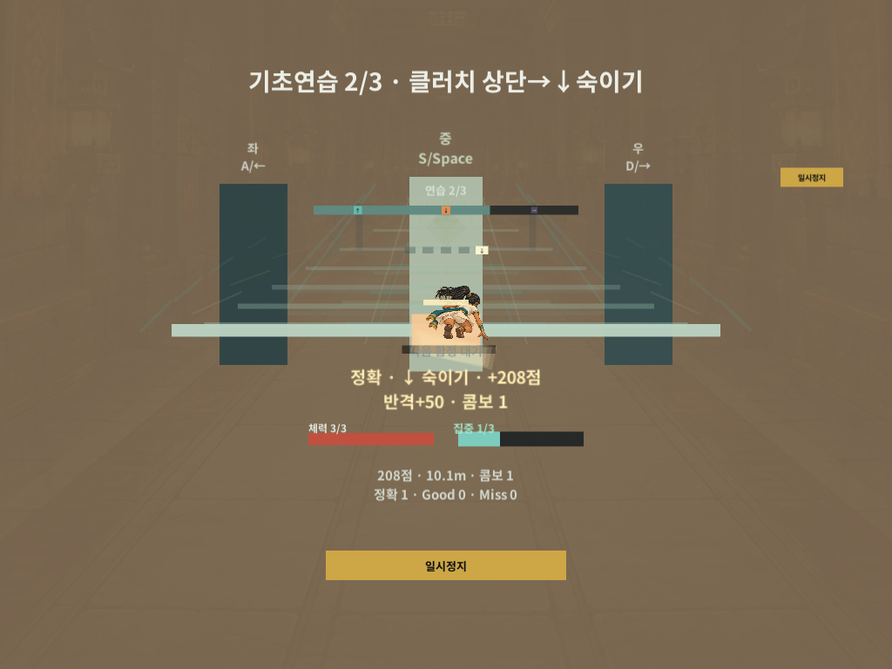
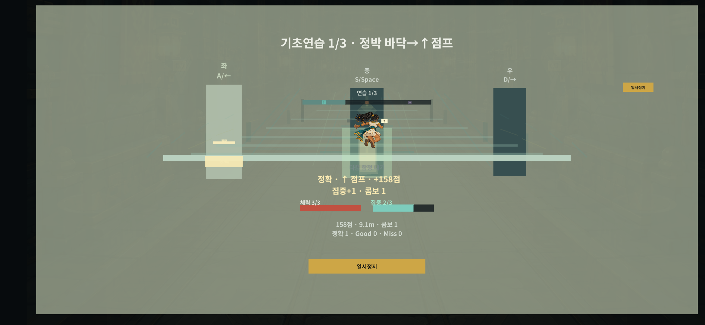
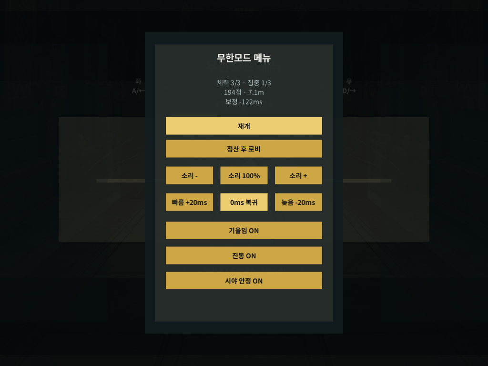

# 이집트 인물의 태블릿·화면 여백 미리보기

2026년 11월 1일 12:52 KST에 만든 **격리 카메라 렌더**다. 실제 태블릿/휴대폰 사진이나 Android APK의 화면이 아니다. 현재 Windows 게임과 같은 `0f7a9b9` 런타임/그림을 쓰는 `b03143b` 시험 사본에 전용 Editor 도우미만 추가했다. 사용자 화면·마우스·키보드 조작은 없었다.

## 태블릿 숙이기

4:3 비율의 1024x768 카메라에서 숙이기 그림·2단계 제목·정확 판정·체력/집중을 함께 확인했다. 같은 비율에서 타이틀/입구·달리기·점프·비틀기·정지·재개도 검사했다.

## 왼쪽 여백의 점프

가로 2340x1080에 왼쪽/아래/오른쪽/위 120/36/24/18픽셀의 가상 여백을 적용했다. 반대쪽 24/36/120/18픽셀도 점프·숙이기·비틀기에 대조했다. 실제 기기의 노치·그립·센서를 측정한 것은 아니다.

## 태블릿 정지 메뉴

이 수치들은 시험 사본/합성 입력의 예시다. 보정 -122ms 같은 표시를 기본값이나 개인 PC/휴대폰 추천 보정으로 가져오지 않는다. PC용 키 표시는 편집기 시험 UI이며 실제 모바일 빌드의 조작 검증이 아니다.

## 확인한 범위

- 총 14장이다. 태블릿 상태 8장과 좌/우 비대칭 여백의 세 회피 6장이며 모든 화면×모든 해상도 전수 검사는 아니다.
- 인물을 숨긴 대조 10개에서 실제 인물 픽셀 2,426~6,498개와 가상 안전 영역 안의 경계를 확인했다. 가짜 그림을 합성하거나 출력 PNG를 자르기/보정하지 않았다.
- 각 프레임의 표시 Text 223회에서 글자 생성 완전성을, 활성 버튼 108회에서 가상 안전 영역의 사각 경계를 확인했다. 이 숫자를 실제 터치 성공·모든 요소의 겹침 없음·기기 가독성 통과로 확대하지 않는다.
- 숙이기 태블릿·정지 태블릿·왼쪽 여백 점프·오른쪽 여백 비틀기의 원본도 눈으로 확인했다. 이번 범위에서 수정할 명확한 잘림은 찾지 못했다.
- 공개 코어 입력으로 만든 결과이며 그림 응답 시계와 UI Update는 시험에서 샘플링했다. 개발 바로가기/임시 무한 코어를 썼으므로 일반 런 완주나 연속 실제 프레임 검증이 아니다.

도우미 렌더 원문은 `Logs/EngineLoopChecks/74c511e0c7a14cf79f3325a51bbc4283/mobile-art-preview-e17207ca8d6a416281f6b32a72cf1087/report.json`, SHA256 `D97F66681AC5DB18E69869F935B5333B044E88966E9B9ECABD305F646E16606A`다. 실행 래퍼 `preview-runner-4418579fc8c44d68ba36e98be0a9718c.json`의 SHA256은 `847BD63F8617959A7AC5D7ACCF5A942316C9A8A8EDF72452D3489B94D6AB9DF3`다. 소유 에디터는 exit 0/종료, 개인 Greed 값과 원본 ProjectSettings는 불변이었다. 기존 게임 코드·실행본은 바꾸지 않았다.

시간 흐름은 [움직임 미리보기](../GreedLast_Prototype_MotionPreview.md), 실제 플레이 순서는 [빠른 확인](../GreedLast_Prototype_QuickCheck.md), APK·기기 준비는 [모바일 실기기 준비](../GreedLast_Prototype_MobileSetup.md)를 따른다. 소리·손맛·센서·휴대폰 지연/FPS는 이 카메라 자료로 확인한 것이 아니다.
