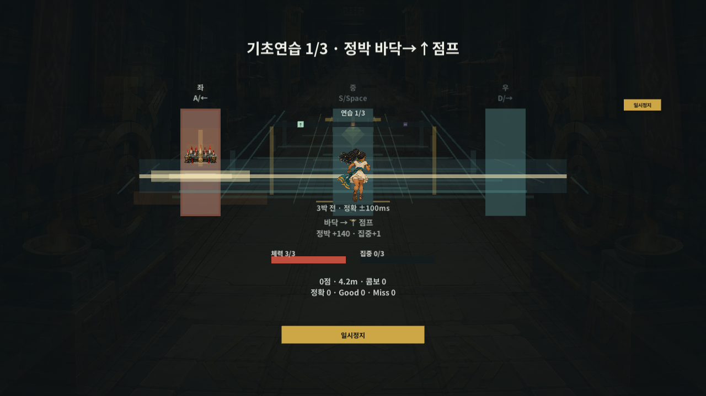
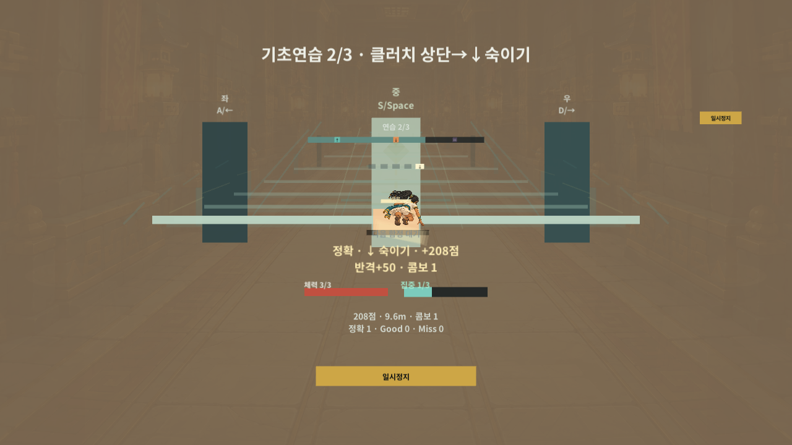

# 이집트 인물의 플레이 미리보기

2026년 10월 30일 소스 `e7b30cb`의 **격리 카메라 렌더**다. 사용자 화면을 촬영하거나 마우스·키보드를 조작하지 않았다. 실행본의 최신 식별과 실제 확인 순서는 [빠른 확인](../GreedLast_Prototype_QuickCheck.md)을 따른다.

## 기본 달리기와 함정

좌·중·우는 이동 레인이 아니라 함정 대응 채널이다. 위 화면은 공개 코어 입력으로 첫 연습 함정을 연 상태다.

## 숙이기 판정 뒤

숙이기 판정 직후에는 해당 그림과 `2/3 숙이기` 제목이 함께 남고, 실제 다음 함정이 시작될 때 `3/3 비틀기`로 바뀐다. 밝은 색은 기존 판정 피드백이며 새 배경을 합성한 것이 아니다. 그림 응답 시계는 중간 포즈로 샘플링했다.

## 확인한 범위

- 같은 입력의 타이틀/입구·달리기·점프·숙이기·비틀기·정지·재개를 가로 1280x720, 작은 960x540, 양쪽 96픽셀 여백을 둔 2340x1080의 10개 렌더로 확인했다. 모든 상태를 모든 해상도에 반복한 전수 검사는 아니다.
- 캐릭터를 잠시 숨긴 대조 렌더와 비교해 여섯 주행/동작 화면에서 실제 인물 픽셀이 출력되는 것을 확인했다. 원본 PNG를 잘라 붙이거나 픽셀을 보정하지 않았다.
- 전체/부분 연습의 정확·Good·오채널 입력에서 18개 실제 단계와 판정 뒤 9개 대기 구간을 대조했다. 다음 단계 표시는 다음 함정과 함께 활성화된다. 판정 수·연습 완료·저장 기회 없음은 유지한다.
- 정지·재개 카운트에서는 이전 회피의 몸체/그림자 이동이 남지 않고 중앙 채널의 응답 방향은 동작 중 박자 위상이 달라져도 유지된다.

렌더 원문: `Logs/EngineLoopChecks/65c7add79c6249229758581d37a64d4d/art-preview-e484a6500a1b457abbdb5399235df5f9/report.json`. 전용 검사: 같은 상위 폴더의 `report.json`. 원문 경로와 해시는 [확인 이력](../GreedLast_Prototype_CheckHistory.md)에 보존한다.

카메라 출력·합성 코어 입력·UI 시계 샘플링 검사다. 실제 Windows 창 입력, 연속 플레이 촬영, 가청 소리·리듬 손맛, 휴대폰 센서·지연·FPS 확인을 뜻하지 않는다. 개인 저장과 원본 프로젝트 설정은 바꾸지 않았다.

점프·숙이기 포즈 표본은 공개 개발 바로가기로 해당 함정을 열고 실제 공개 판정 입력으로 만든 결과다. 비틀기는 선택 없이 이어지는 임시 무한 코어에서 도달했다. 개발 바로가기 표본을 일반 완주나 사용자 조작 성공으로 세지 않는다.
