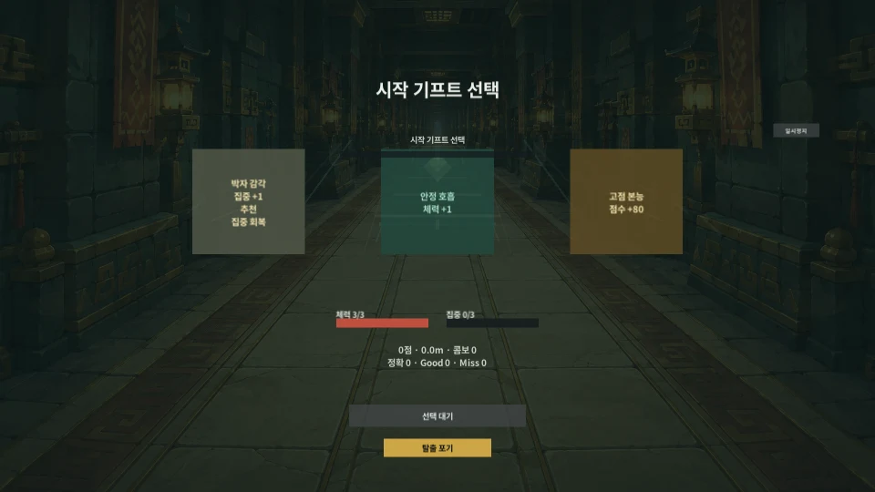

# Greed 움직임 미리보기

이집트풍 인간 주자의 **무음 움직임 자료**다. 맨 위는 10월 31일 `0f7a9b9`의 출발 중 정지/새 재개이며, 앞선 `e934d9d`의 출발·일반 런 전체와 10월 30일 동작·교체 전 자료도 입력별로 보존한다. 실제 엔진 프레임 UI의 카메라 렌더이며 사용자 화면 촬영·손 조작이나 소리/휴대폰 확인이 아니다. 현재 실행본과 직접 누르는 순서는 [빠른 확인](GreedLast_Prototype_QuickCheck.md)을 따른다.

## 출발 직후 정지와 새 재개

**4.73초 / 960x540 / 약 308KB**. 첫 기프트 선택 뒤 아직 진행 중인 입구 연출에서 멈춘다. 정지 메뉴에서는 주자의 크기·알파와 거리 0이 고정되고, 새 재개 카운트와 앞 여유를 거쳐 첫 함정으로 이어진다. 이미 시작했던 입구 연출을 다시 재생하지 않는다.

새 별도 Windows 제품의 실제 기초 연습 뒤 로비에서 일반 런을 열었다. 원본 79장 중 이 경계의 41표본을 골라 31압축 프레임으로 묶었다. 실제 정지 표본 6개는 모두 크기 1.4·알파 1·거리 0이며 시계를 수동 조작하지 않았다. 첫 함정 초반에서 끝나고 완주·저장·무한 검사가 아니다. 자동 앱 명령 자료이며 실제 ESC/터치·가청 소리 검사는 아니다.

크기 변경·자르기·픽셀 보정 없이 같은 간격 규칙으로 인코딩했다. 전 프레임의 크기·길이·비어 있지 않은 변화와 원본 시각별 화질 대조 6개(최소 PSNR 38.244dB)를 확인했고, 출발·정지·첫 함정의 재디코딩 PNG도 로컬에서 보았다. 사본 Editor의 재열기 식별자, 소유 빌드/플레이어 종료와 개인 저장·원본 설정·당시 실행본 불변을 확인했다. [이 파일 식별](Media/2026-10-31/entrance-pause-index.json)에 입력과 해시를 구분한다. 손맛·휴대폰/FPS 확인을 뜻하지 않는다.

## 앞선 13시 21분 입력의 출발과 한 판 전체

아래 두 파일은 게임·Editor/빌드 `e934d9d`의 자료다. 이번 `0f7a9b9` 정지 수정의 새 완주 검사로 소급하지 않는다.

**첫 기프트 대기 → 선택 뒤 출발 / 3.80초**: 기프트를 고르는 동안 연출을 쓰지 않고, 선택 뒤 출발 카운트에서 주자가 작게 나타나 주행 크기로 이어진다. 끝은 첫 함정 초반이며 완주 장면은 아니다.

[앞선 첫 기프트 선택과 한 번만 시작하는 출발](Media/2026-10-31/Greed-Egyptian-Opening-Departure.webp)

[현재 인물의 일반 런 전체 / 34.35초, 약 4.7MB](Media/2026-10-31/Greed-Egyptian-Normal-Run.webp)

시작 기프트부터 4장과 각 선택·중반 유물·공명핵·탈출 게이트·클리어 요약까지 이어진다. 결과는 자동 정확 15·Good 0·Miss 0, 7,044점/100.48m였다. 저장 슬롯 선택/저장 없이 로비 버튼이 보이는 결과에서 끝나며 저장·무한 실행까지 찍은 영상은 아니다. 자동 입력의 오차·추천 보정과 선택 대기 시간을 사람의 보정값·난이도·밸런스 기준으로 사용하지 않는다.

- 서로 다른 새 별도 제품의 원본은 71장/263장이다. 각각 실제 기초 연습을 마치고 로비로 돌아와 일반 런을 열었으며 공개한 것은 출발 32표본과 일반 런 219표본이다. 전체 334원본 중 251표본을 사용했다.
- 출발은 원본 960x540, 전체 런은 처음부터 640x360 카메라로 렌더했다. 자르기·크기 변경·픽셀 보정 없이 WebP로 묶었다. 두 파일 약 5.0MB·242압축 프레임이며 같은 인접 화면은 합쳐져도 길이가 유지된다. 표본 간격을 10ms로 반올림하고 끝은 1초 유지하며 반복한다. 표본 수·부드러움은 실제 게임 FPS가 아니다.
- 모든 압축 프레임을 다시 읽어 길이·크기·반복·비어 있지 않은 화면 변화를 대조했다. 출발 첫 세 표본을 포함한 원본 시각별 화질 대조 9건의 최소 PSNR은 36.23dB였다. 이는 코덱 검사이지 모든 픽셀/폰 성능의 보증이 아니다. [이번 파일 식별](Media/2026-10-31/preview-index.json)에 해시를 뒀다.
- 실제 앱 명령과 엔진 프레임이며 그림/코어 시계나 UI Update를 수동 호출하지 않았다. 새 Editor 재열기에서도 사본의 제품명이 개인용과 분리됨을 확인했다. 개인 저장·원본 설정·정식 실행본은 불변이고 빌드/플레이어 프로세스는 종료했다. 사람의 입력·가청 소리·휴대폰 센서/지연은 확인하지 않았다.

근거와 실제 실행본은 [확인 이력](GreedLast_Prototype_CheckHistory.md), 직접 처음부터 볼 별도 제품은 [새 시작용 체험 실행본](GreedLast_Prototype_Demo.md)을 따른다.

## 10월 30일 인물 동작 자료

아래 일곱 개는 소스 `ea0a61f`·`b72a11b`/게임 `e7b30cb`의 두 별도 제품 자료다. 같은 인물/포즈를 쓰지만 이번 출발 수정 뒤 새로 찍거나 새 게임의 전체 검증으로 세지 않는다. 현재 자료가 한꺼번에 자동 재생되지 않도록 앞선 클립은 링크로 보존한다.

### 네 동작 장면

**연습 / 7.64초**: 점프·숙이기와 현재 단계 제목, 마지막 판정 뒤 결과로 이어지는 흐름이다. 마지막 연습 판정은 즉시 결과로 넘어가므로 비틀기 그림은 다음 별도 장면에서 본다.

[10월 30일 인간 주자의 연습 자동 진행](Media/2026-10-30/Greed-Egyptian-Practice.webp)

**선택 전환 없는 비틀기 / 4.23초**: 일반 런 중간 구간에서 실제 비틀기 그림과 기본 달리기 복귀를 본다.

[10월 30일 인간 주자의 비틀기와 달리기 복귀](Media/2026-10-30/Greed-Egyptian-Twist.webp)

**제한된 회전 / 3.89초**: 회전 통로와 고정된 HUD·판정선이다. 실제 폰을 돌린 자료가 아니다.

[10월 30일 인간 주자의 회전 통로 대응](Media/2026-10-30/Greed-Egyptian-Rotation.webp)

**탈출 막바지 / 8.82초**: 탈출 구간의 마지막 대응과 클리어 요약·저장 선택 연결을 본다.

[10월 30일 인간 주자의 탈출 막바지와 결과](Media/2026-10-30/Greed-Egyptian-Escape.webp)

### 판정과 재개 비교

[Good 세 번 / 8.31초](Media/2026-10-30/Greed-Egyptian-Good.webp): 정확 0·Good 3·Miss 0, 체력 3으로 끝난다. 의도적으로 늦은 Good를 넣은 표본이므로 화면의 추천 보정 -200ms는 사용자의 실제 보정값이 아니다. 이 값을 적용하지 않았다.

[첫 오입력 / 7.97초](Media/2026-10-30/Greed-Egyptian-Wrong-Channel.webp): 첫 함정의 다른 채널로 피해를 받고 이후 두 동작을 정확으로 처리한다. Miss 1·체력 2가 유지되어 첫 오입력이 뒤의 정답으로 바뀌지 않는다.

[회피 직후 정지와 재개 / 4.30초](Media/2026-10-30/Greed-Egyptian-Pause-Resume.webp): 첫 정확 대응 직후 메뉴를 열고, 재개 카운트와 앞 여유 뒤 다음 함정으로 이어진다. 이미 끝난 함정을 다시 판정하는 장면은 아니다. 정지의 실제 두 표본에서 몸체 위치/회전·그림자 복귀와 거리 동결을 대조했다. 앱 명령으로 진행했으며 실제 ESC 입력은 아니다.

### 10월 30일 자료의 범위

- 개인 저장과 분리한 새 Windows 제품 두 개의 원본은 일반/연습 237장과 판정/재개 비교 107장이다. 일곱 클립은 총 232표본을 사용하며 전체 일반 런 영상은 아니다. 첫 제품은 자동 앱 명령으로 정확 15·Good 0·Miss 0, 7,044점/100.8m로 탈출했다. 자동 선택 대기·거리/오차를 사람의 플레이 시간·밸런스나 입력 지연으로 해석하지 않는다.
- 그림/코어 시계나 게임 코드는 바꾸지 않았다. 시험 전용 녹화 단계만 현재 시험 자료에 추가했다. 비교 코스의 재시작은 현재 시간의 공개 코어 명령이며 입력/정지/재개는 실제 앱 명령이다. 엔진 프레임에서 점프/숙이기 그림의 제목도 대조했으며 손맛·가청 소리·센서 검사를 대신하지 않는다.
- 960x540 원본을 자르거나 크기를 바꾸지 않고 WebP로 압축했다. 표본 간격은 10ms 단위로 반올림하고 마지막 화면을 1초 유지하며 반복한다. 표본 수·부드러움은 실제 게임 FPS가 아니다.
- 일곱 파일 약 8.8MB를 모두 다시 디코딩해 클립별 합계 228프레임·길이·크기·반복을 확인했다. 정지 클립의 동일한 인접 표본 21장은 17프레임으로 합쳐져도 전체 길이는 같다. 시작/중간/끝을 원본 시간에 맞춘 21개 코덱 대조는 최소 PSNR 36.26dB였다. 모든 픽셀·상용 화질·실기기 성능의 전수 검사는 아니다. [파일 식별](Media/2026-10-30/preview-index.json)에 각 해시가 있다.
- 새 에디터 재열기에서도 시험 제품명이 개인용과 분리됨을 확인했다. 개인 저장·원본 설정·14:21 사용자 실행본은 불변이며 빌드/시험 프로세스는 종료했다. 화면이나 마우스·키보드는 조작하지 않았다.

현재 그림 자체는 [카메라 미리보기](ArtDrafts/EgyptianRunnerPreview-20261030.md), 근거는 [확인 이력](GreedLast_Prototype_CheckHistory.md)을 따른다.

## 10월 25일 자료 보존

아래는 인물 교체 전 소스 `19f17b0`/게임 `ac98d1e`의 자료다. 그때의 규칙과 개인 실행본을 바꾸지 않았으며 이후 구현 검증으로 다시 세지 않는다. 이전 인물이 현재 자료 옆에서 자동 재생되지 않도록 링크로 보존한다.

## 먼저 볼 세 장면

**세 회피 동작 / 7.61초**: 바닥 점프, 상단 숙이기, 측면 비틀기와 정확 피드백을 본다.

[이전 인물의 세 동작 연습](Media/2026-10-25/Greed-Practice.webp)

**제한된 회전 / 3.64초**: 회전 통로의 변주와 고정된 제목·HUD·판정선을 본다. 실제 폰을 돌린 기록은 아니다.

[이전 인물의 회전 통로와 다음 경로 선택](Media/2026-10-25/Greed-Rotation.webp)

**핵 이후 탈출 / 8.02초**: 공명핵만으로 끝나지 않고 게이트 대응 뒤 결과와 저장 선택으로 이어지는지 본다.

[이전 인물의 공명핵 이후 탈출 게이트와 결과](Media/2026-10-25/Greed-Escape.webp)

## 판정과 재개 비교

**Good / 8.32초**: 같은 연습의 세 동작을 Good로 통과한다. 이 샘플은 Good 3회·Miss 0회·체력 3으로 끝났으며 정확의 보상과 구분된다.

[이전 인물의 Good 세 번 생존과 피드백](Media/2026-10-25/Greed-Good.webp)

**오입력 / 8.00초**: 첫 함정의 다른 채널 입력으로 피해를 받고, 이후 두 동작을 정확으로 처리한다. 끝까지 Miss 1회·체력 2가 유지되며 첫 오입력이 나중 성공으로 바뀌지 않는다.

[이전 인물의 첫 오입력과 이후 대응](Media/2026-10-25/Greed-Wrong-Channel.webp)

**정지와 재개 / 3.12초**: 흐릿한 배경의 별도 메뉴, 정지 중 진행 동결, 재개 카운트와 같은 함정 앞 여유를 본다. 앱 명령으로 진행했으며 실제 ESC나 창 전환 검사가 아니다.

[이전 인물의 정지 메뉴와 같은 함정 재개](Media/2026-10-25/Greed-Pause-Resume.webp)

## 한 판 전체

[일반 런 전체 미리보기 / 34.31초, 약 4.6MB](Media/2026-10-25/Greed-Normal-Run.webp)

시작 기프트→4장과 각 선택→공명핵→탈출 결과다. 자동 입력 샘플의 실제 결과는 7,044점·100.48m·정확 15·Good 0·Miss 0이었다. 선택 대기 시간을 사람이 정한 플레이 시간이나 밸런스 기준으로 해석하지 않는다.

## 저장과 무한 연결

[저장 슬롯 선택→S3 한 번 저장→정비 완료/취소→첫 시작 / 11.35초](Media/2026-10-25/Greed-Save-Prepare.webp)

[첫 자연 종료→목표가 있는 재정비→두 번째 시작 / 4.77초](Media/2026-10-25/Greed-Prepared-Retry.webp)

[저장 이후 실제 두 번 사용→자동 비움→로비 전체 / 36.09초](Media/2026-10-25/Greed-Two-Uses.webp)

준비 취소는 2회 그대로, 첫 실제 시작은 1회, 두 번째 실제 시작은 슬롯이 자동으로 빈 뒤에도 현재 런이 계속됐다. 두 자연 종료 뒤에는 일반 클리어 1·무한 기록 2·빈 슬롯 세 칸·새 저장 후보 없음이었다. 이번 자동 진행에서는 실제 UI 텍스트의 완료 요약 세 번을 읽어 기프트/유물→성향→시작 상태와 결과 뒤 목표가 첫 본문 블록에 있는지도 확인했다.

[이전 실행본 UI의 준비 완료와 다음 목표](Media/2026-10-25/Greed-Prepared-Summary.png)

## 확인 범위

- 2026-10-25, 소스 `19f17b0` / 게임 입력 `ac98d1e`의 별도 Windows 시험 제품 세 개에서 만들었다. 개인 저장·원본 PlayerSettings·개인용 실행본은 불변이다.
- 실제 엔진 프레임의 UI를 별도 카메라로 렌더했다. 입력은 자동 앱 명령이며 OS 게임 창 캡처나 사람의 손 플레이가 아니다. 시험 전용 캡처 코드는 정식 실행본에 넣지 않았다.
- 640×360 표본을 WebP로 묶었다. 표본 사이 간격을 10ms 단위로 반올림하고 마지막 화면은 1초 유지하며 반복한다. 이 애니메이션의 표본 수나 부드러움을 실제 게임 FPS·입력 지연으로 판단하지 않는다.
- 열 애니메이션은 다시 디코딩해 프레임 변화·전체 재생 길이·크기·반복과 원본 해시를 확인했다. 같은 인접 화면이 합쳐져도 전체 길이는 유지된다. 파일별 식별은 [미리보기 목록](Media/2026-10-25/preview-index.json)에 있다.
- 이번 실제 Windows 창 활성화 시도는 두 번 실패해 입력 0회로 중단했다. 이 미리보기로 새 UI의 실제 창 조작·저장/두 번 사용·정상 창 종료 검증을 대신 통과 처리하지 않는다.
- 사람의 리듬 손맛과 소리, 휴대폰 그립·기울임·두 손가락·앱 전환·지연/FPS는 직접 확인이 남는다. 이번에는 판정 폭·점수·피해·저장 규칙을 변경하지 않았다.

직접 볼 때는 **앞으로 달리는가 → 위험과 동작이 읽히는가 → 정확이 더 이로운가 → 회전이 어지럽지 않은가 → 탈출이 한 판의 끝으로 느껴지는가** 순서로 평가한다. 이 다섯 감각의 재현 가능한 불편을 다음 수정 기준으로 삼는다.
