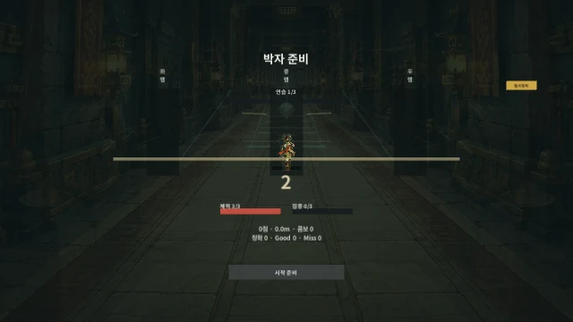
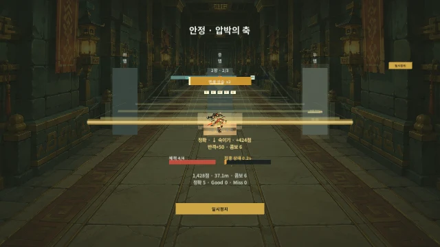
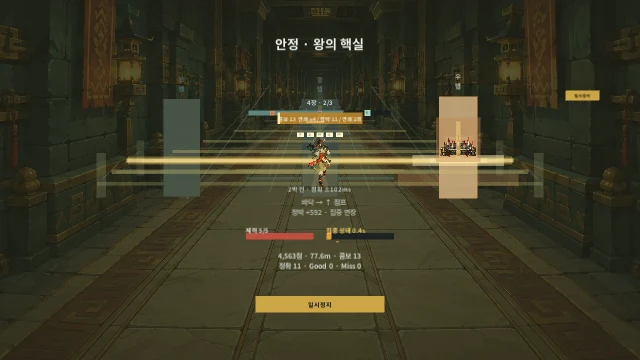
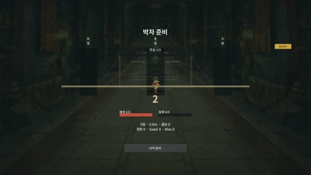
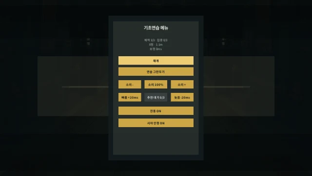
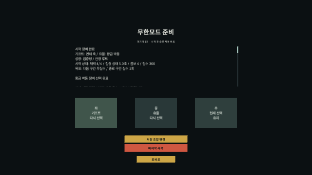

# Greed 움직임 미리보기

게임을 열기 전에 대표 흐름을 짧게 보는 **무음 애니메이션**이다. 촬영 기준은 소스 `19f17b0`/게임 입력 `ac98d1e`이며, 이 자료 제작 당시 게임 규칙과 개인용 실행본을 바꾸지 않았다. 이후 생성 프레임 입력 보호 등의 새 구현 검증으로 영상을 다시 세지 않는다. 최신 실행본과 직접 누르는 순서는 [빠른 확인](GreedLast_Prototype_QuickCheck.md)을 따른다.

## 먼저 볼 세 장면

**세 회피 동작 / 7.61초**: 바닥 점프, 상단 숙이기, 측면 비틀기와 정확 피드백을 본다.

**제한된 회전 / 3.64초**: 회전 통로의 변주와 고정된 제목·HUD·판정선을 본다. 실제 폰을 돌린 기록은 아니다.

**핵 이후 탈출 / 8.02초**: 공명핵만으로 끝나지 않고 게이트 대응 뒤 결과와 저장 선택으로 이어지는지 본다.

## 판정과 재개 비교

**Good / 8.32초**: 같은 연습의 세 동작을 Good로 통과한다. 이 샘플은 Good 3회·Miss 0회·체력 3으로 끝났으며 정확의 보상과 구분된다.

**오입력 / 8.00초**: 첫 함정의 다른 채널 입력으로 피해를 받고, 이후 두 동작을 정확으로 처리한다. 끝까지 Miss 1회·체력 2가 유지되며 첫 오입력이 나중 성공으로 바뀌지 않는다.

**정지와 재개 / 3.12초**: 흐릿한 배경의 별도 메뉴, 정지 중 진행 동결, 재개 카운트와 같은 함정 앞 여유를 본다. 앱 명령으로 진행했으며 실제 ESC나 창 전환 검사가 아니다.

## 한 판 전체

[일반 런 전체 미리보기 / 34.31초, 약 4.6MB](Media/2026-10-25/Greed-Normal-Run.webp)

시작 기프트→4장과 각 선택→공명핵→탈출 결과다. 자동 입력 샘플의 실제 결과는 7,044점·100.48m·정확 15·Good 0·Miss 0이었다. 선택 대기 시간을 사람이 정한 플레이 시간이나 밸런스 기준으로 해석하지 않는다.

## 저장과 무한 연결

[저장 슬롯 선택→S3 한 번 저장→정비 완료/취소→첫 시작 / 11.35초](Media/2026-10-25/Greed-Save-Prepare.webp)

[첫 자연 종료→목표가 있는 재정비→두 번째 시작 / 4.77초](Media/2026-10-25/Greed-Prepared-Retry.webp)

[저장 이후 실제 두 번 사용→자동 비움→로비 전체 / 36.09초](Media/2026-10-25/Greed-Two-Uses.webp)

준비 취소는 2회 그대로, 첫 실제 시작은 1회, 두 번째 실제 시작은 슬롯이 자동으로 빈 뒤에도 현재 런이 계속됐다. 두 자연 종료 뒤에는 일반 클리어 1·무한 기록 2·빈 슬롯 세 칸·새 저장 후보 없음이었다. 이번 자동 진행에서는 실제 UI 텍스트의 완료 요약 세 번을 읽어 기프트/유물→성향→시작 상태와 결과 뒤 목표가 첫 본문 블록에 있는지도 확인했다.

## 확인 범위

- 2026-10-25, 소스 `19f17b0` / 게임 입력 `ac98d1e`의 별도 Windows 시험 제품 세 개에서 만들었다. 개인 저장·원본 PlayerSettings·개인용 실행본은 불변이다.
- 실제 엔진 프레임의 UI를 별도 카메라로 렌더했다. 입력은 자동 앱 명령이며 OS 게임 창 캡처나 사람의 손 플레이가 아니다. 시험 전용 캡처 코드는 정식 실행본에 넣지 않았다.
- 640×360 표본을 WebP로 묶었다. 표본 사이 간격을 10ms 단위로 반올림하고 마지막 화면은 1초 유지하며 반복한다. 이 애니메이션의 표본 수나 부드러움을 실제 게임 FPS·입력 지연으로 판단하지 않는다.
- 열 애니메이션은 다시 디코딩해 프레임 변화·전체 재생 길이·크기·반복과 원본 해시를 확인했다. 같은 인접 화면이 합쳐져도 전체 길이는 유지된다. 파일별 식별은 [미리보기 목록](Media/2026-10-25/preview-index.json)에 있다.
- 이번 실제 Windows 창 활성화 시도는 두 번 실패해 입력 0회로 중단했다. 이 미리보기로 새 UI의 실제 창 조작·저장/두 번 사용·정상 창 종료 검증을 대신 통과 처리하지 않는다.
- 사람의 리듬 손맛과 소리, 휴대폰 그립·기울임·두 손가락·앱 전환·지연/FPS는 직접 확인이 남는다. 이번에는 판정 폭·점수·피해·저장 규칙을 변경하지 않았다.

직접 볼 때는 **앞으로 달리는가 → 위험과 동작이 읽히는가 → 정확이 더 이로운가 → 회전이 어지럽지 않은가 → 탈출이 한 판의 끝으로 느껴지는가** 순서로 평가한다. 이 다섯 감각의 재현 가능한 불편을 다음 수정 기준으로 삼는다.
