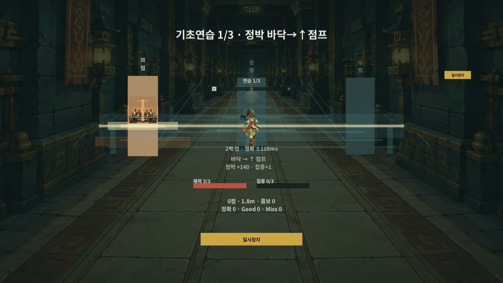

# Greed

기획서의 조작 감각과 대표 한 판을 확인하는 Unity 모바일 리듬 탈출 프로토타입이다. Unity 프로젝트 표시명은 `greed last`다.

[처음부터 확인하기](Docs/GreedLast_Prototype_QuickCheck.md) · [기획과 구현 범위](Docs/GreedLast_Prototype_PlanCoverage.md) · [검증 이력](Docs/GreedLast_Prototype_CheckHistory.md)

Windows 시험 플레이어의 실제 연습 상태를 오프스크린으로 그린 화면이다. OS 창 캡처나 손/휴대폰 성능 검사는 아니다.

## 시작

1. Unity Hub에서 이 저장소 폴더를 Unity 6.4 `6000.4.3f1`로 연다.
2. `Assets/Scenes/GreedLast_Boot.unity`를 연다.
3. Game 뷰를 가로 화면으로 두고 Play한다. 시작 화면에서 입구 로비로 이어진다.
4. 기초 연습의 좌·중·우 대응과 세 동작을 본 뒤 일반 런으로 들어간다.

좌·중·우는 이동할 레인이 아니라 위험에 대응하는 채널이다. 자세한 조작과 이번 우선 확인은 [빠른 확인](Docs/GreedLast_Prototype_QuickCheck.md)을 따른다.

## 대표 흐름

직선 주행 → 함정 회피와 정확 타이밍 보상 → 루트·기프트·유물 선택 → 공명핵 회수 → 탈출 → 원하는 한 칸에 한 번 저장 → 무한 정비 → 실제 두 번째 시작에 슬롯 자동 비움 → 시작한 런 유지/기록으로 이어진다.

일반 런은 4장과 탈출의 대표 코스로 압축했다. 완성 상용 게임 전체나 길드·계정·결제·서버 운영 기능을 목표로 하지 않는다. 회전은 통로에 제한적으로 적용하며 실제 폰 센서/소리 지연·손맛은 기기에서 별도로 확인한다.

## 검증과 Windows 빌드

- Play를 중지한 뒤 `Greed Last > Run Prototype Smoke Check`로 편집기 통합 검사를 실행한다.
- `Greed Last > Build Verified Windows Prototype`은 스모크 후 비개발 Windows 실행본과 식별 자료를 만든다. Windows Build Support가 필요하다.
- 로컬 실행 경로는 `Builds/GreedLastPrototype/GreedLastPrototype.exe`다. 검증 범위와 최신 실행본 식별은 [확인 이력](Docs/GreedLast_Prototype_CheckHistory.md)을 따른다.
- 무적·바로가기·위협 조절은 에디터/개발 빌드 전용이다. 확인용으로 개인 진행도나 보관할 조합을 초기화·소모하지 않는다.
- 실제 종료/새 프로세스의 저장 검사는 [실행 파일 검증](Docs/GreedLast_Prototype_PlayerChecks.md)을 따른다. 시험 전용 복사본/제품을 쓰며 정식 실행본에 시험 코드를 넣지 않는다.
- 새 사본의 전체 엔진 검사는 `tools/check-engine-loop.ps1`, 짧은 함정 예고/재개 검사는 `-CueOnly`다. 개인 저장소와 분리해 두 재로딩 방식을 확인하며, 준비 조건/범위는 같은 [검증 절차](Docs/GreedLast_Prototype_PlayerChecks.md#새-사본의-엔진-검사-도구)를 따른다.

## 저장소 구성

- `Assets`, `Packages`, `ProjectSettings`: Unity 프로젝트 소스·자원·설정.
- `Docs`: 기획 범위, 구현 기준, 직접 확인 순서와 검증 이력.
- `tools`: 로컬 배포 파일/초기 구동 확인 도구.
- `Library`, `Builds`, `Logs`, `UserSettings`와 개인 저장값은 GitHub에 포함하지 않는다. 저장소에서 실행 파일이나 검사 원시 자료를 내려받는 형태는 아니다.

포함 글꼴의 고지는 [Noto Sans KR](Assets/ThirdParty/NotoSansKR/NOTICE.txt), [KR OFL](Assets/ThirdParty/NotoSansKR/OFL.txt), [Symbols 2 OFL](Assets/ThirdParty/NotoSansSymbols2/OFL.txt)을 참고한다.
